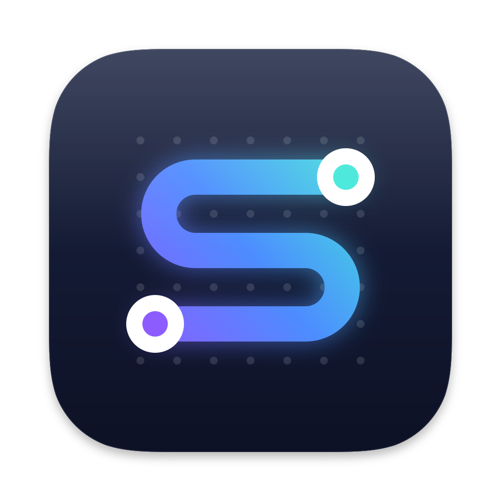

# Slatrix

A native macOS client for [Matrix](https://matrix.org) that works the way Slack does.

Teams that move from Slack to Matrix keep their habits: the sidebar with channels and direct messages, threads in a side pane, reactions, ⌘K to jump anywhere, the same keyboard shortcuts. Underneath it is Matrix, so the server is yours and private conversations are end-to-end encrypted. People on any other Matrix client can join the same rooms.

Slatrix is written in SwiftUI and AppKit on top of the official [Matrix Rust SDK](https://github.com/matrix-org/matrix-rust-sdk). It uses no web view.

## What it does

- Spaces as workspaces, with channels, direct messages and starred conversations in the sidebar
- Threads, replies, reactions, edits, pins, forwarding and file sharing
- Unread and mention badges, Activity, Later, drafts and desktop notifications
- Message search across encrypted rooms, backed by a local index
- Device verification and key recovery for encrypted history
- Zoom from 80% to 200% with ⌘= and ⌘-

You can try a sample workspace from the sign-in screen without an account.

## Build

You need an Apple Silicon Mac with macOS 14 or later, and either Xcode 16 or later or the Command Line Tools with the macOS 26 SDK.

```sh
scripts/build-app.sh
open build/Slatrix.app
```

The first build compiles the Matrix Rust SDK for macOS, which takes about ten minutes. Rust is installed into `.build/` and your system toolchain is left alone. The SDK revision and the few patches applied on top of it are described in [Support/MatrixSDK](Support/MatrixSDK/README.md).

## Develop

```sh
scripts/test.sh
```

Conventions for contributors, human or agent, are in [AGENTS.md](AGENTS.md).

## Updates

Slatrix updates itself from GitHub releases with [Sparkle](https://sparkle-project.org). [RELEASING.md](RELEASING.md) explains how to ship a version.

## License

[Apache 2.0](LICENSE)
